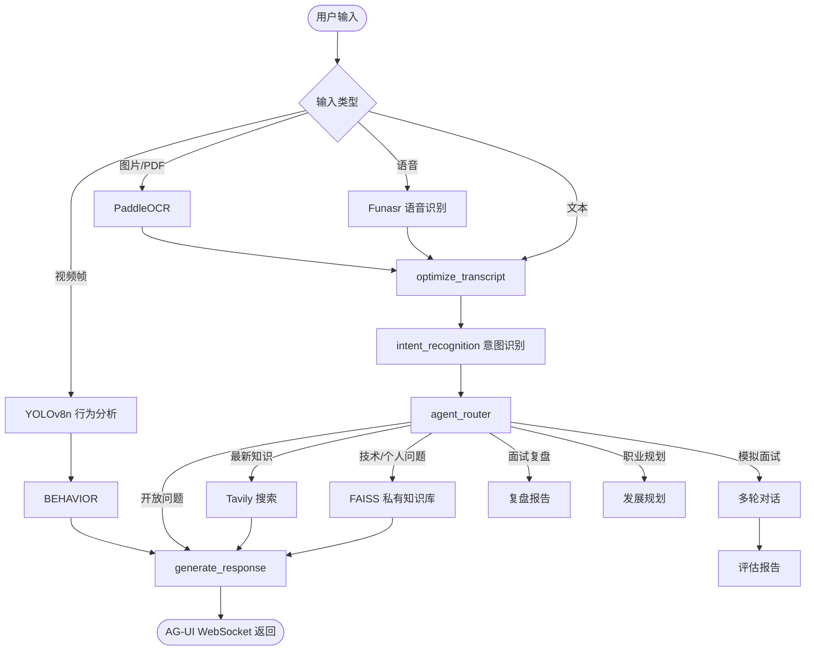
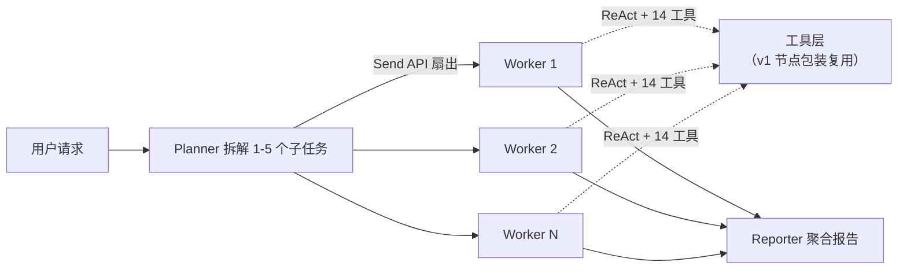
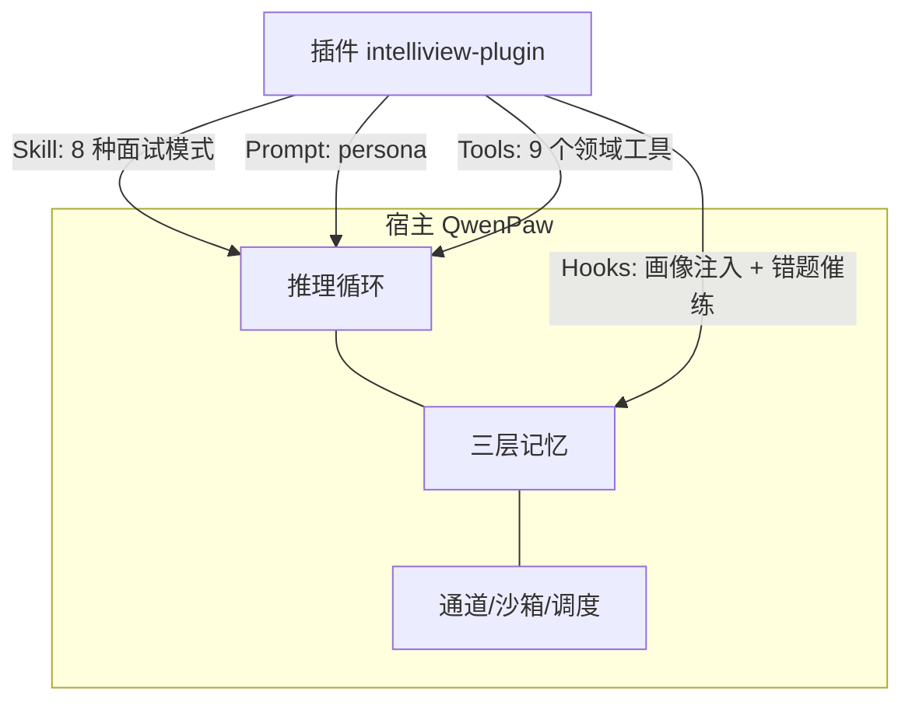
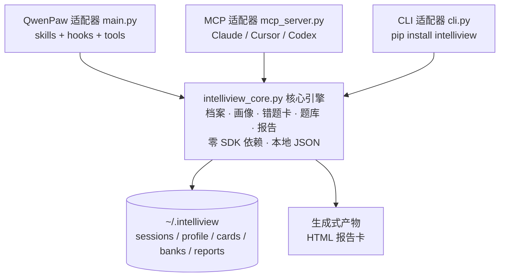

# Changelog

本项目的所有重要变更都记录在此。格式参考 [Keep a Changelog](https://keepachangelog.com/zh-CN/1.1.0/)，版本遵循 [SemVer](https://semver.org/lang/zh-CN/)。

> 本项目同时是一部**架构演化史**：从 LangGraph 全栈单体 → 多 Agent 编排 → QwenPaw 插件 → 一引擎多适配器。完整演化过程（含架构图与升级路径）见文末[「附录 · 架构演化史」](#附录--架构演化史)。

## [0.7.0] - 2026-11-28

### Added

- **题库 3 → 9 包**（各 12 题，含追问，难度三档齐全）：
  - `backend-java`：JVM / 并发 / Spring / 分布式 / 线上排查
  - `backend-go`：GMP 调度 / channel / GC / pprof / 优雅退出
  - `algorithm-advanced`：DP 降维 / 图论 / 二分答案 / 单调栈 / 均摊分析
  - `ml-engineer`：经典 ML / 深度学习 / LLM 与 RAG / 线上监控与 A/B
  - `product-manager`：需求判断 / 数据驱动 / 用户研究 / 商业化
  - `behavioral-english`：英文行为面（STAR 结构，追问全部要求量化证据）
- **Issue 模板**（`.github/ISSUE_TEMPLATE/`）：Bug / Feature / 新岗位包提案（标注 `good first issue` 路径）

### Changed

- README / questions/README 的岗位包数量说明同步为 9 包。

## [0.6.0] - 2026-11-28

### Added

- **开源题库（岗位包飞轮）**：
  - `questions/` 目录：3 个初始岗位包（`backend-python` / `frontend-react` / `algorithm-fundamentals`，各 12 题，含追问）
  - `intelliview bank list / show <id> / use <id> / validate [路径]` 四个命令：一键导入并激活岗位包，后续模拟面试按题库出题
  - `questions/question-pack.schema.json`：题包 JSON Schema，贡献者照着填即可
  - 用户自定义包：放到 `~/.intelliview/question_packs/` 自动被发现
  - 题包随 pip 包分发（`intelliview_questions` 数据包），安装后离线可用
- **README 首屏 demo**：
  - `docs/assets/demo.gif`：终端模拟面试会话动图（画像驱动出题 → 追问 → 工具落盘 → 评分报告）
  - `docs/assets/report-card.png`：HTML 报告卡实拍
- **演示数据命令**：`intelliview demo` —— 免 LLM 写入 2 次面试档案 + 错题卡 + 激活题库并渲染报告卡，5 秒看到完整产品形态。

### Added（工程）

- CI：`.github/workflows/question-packs.yml` 校验全部题包 + 引擎导入自检（贡献者 PR 自动跑）
- PR 模板：`.github/pull_request_template.md`（题包质量 checklist）

## [0.5.0] - 2026-11-28

### Added

- **独立 CLI（`intelliview` 命令）**：不依赖任何 Agent 宿主，终端里直接用。
  - `intelliview` / `intelliview chat "练一下 Redis"` — 自由对话（function calling 驱动全部 9 个引擎工具）
  - `intelliview interview` — 一键模拟面试；`intelliview drill` — 今日错题特训
  - `intelliview profile / history / report <id> / cards` — 免 LLM 直读本地档案
  - 任意 OpenAI-compatible 端点：`INTELLIVIEW_BASE_URL` / `INTELLIVIEW_MODEL` / `INTELLIVIEW_API_KEY`（或 `OPENAI_API_KEY`）
- **PyPI 安装形态**：`pyproject.toml`（`pip install intelliview` 就绪）+ `intelliview-plugin/__init__.py` 包化。
- CLI 离线测试套件（fake OpenAI client，验证工具调用落盘闭环）。

### Changed

- **工具 schema 下沉到引擎**：`TOOL_DEFINITIONS` 成为 9 个工具的唯一定义源（name / description / input_schema / method），QwenPaw 适配器只保留注册循环，新增运行时无需改两处。
- **本地运行时上下文下沉**：`LocalStorage / LocalMedia / LocalContext` 移入引擎，MCP server 删除自带副本，改为与 CLI 共享。
- 文档拆分：README 只留产品介绍，全部版本历史移入本文件。

## [0.4.0] - 2026-11-28

### Added

- **核心引擎抽离**：`intelliview_core.py` 零 SDK 依赖（QwenPaw / MCP / CLI 共享），含 9 个工具 handler 与 `EngineResult` 结构。
- **MCP 适配器**（`mcp_server.py`）：Claude Desktop / Cursor / Codex / Windsurf 等任何 MCP 客户端可用。
- MIT License。

### Changed

- 去个人化：persona / SKILL / 工具描述去掉个人信息，仓库公开可用。
- git 历史清洗：个人邮箱/手机号替换为 GitHub noreply 邮箱。

## [0.3.0] - 2026-11-25

### Added

- **错题闭环**：
  - 面试中评分 ≤6 的题自动生成错题卡（丢分点 + 参考答案要点）
  - 间隔重复 1→3→7→14→30→60 天；连续答对 3 次标记掌握，答错重置为次日
  - `drill_weaknesses` 变式出题重测（换场景/换数字/反着问）+ 60 秒限时
  - `update_error_card` 记录重测结果
- **到期催练**：PRE_DISPATCH 钩子每次对话自动提醒今日到期错题。

## [0.2.0] - 2026-11-25

### Added

- **数据基座**（让对话产生数据）：
  - `save_interview_session`：每次面试落盘 `sessions/`（JSON+MD）
  - `load_user_profile`：跨会话用户画像（维度均分 / 高频弱点 / 进步曲线）
  - PRE_DISPATCH 钩子自动注入画像上下文
- `generate_interview_report`：五维 1-10 评分 + 历史对比
- `build_question_bank`：粘贴 JD → 持久化针对性题库并激活
- `list_interview_history`：历次面试 + 进步趋势
- `render_report_card`：自包含 HTML 报告卡（雷达图 / 能力卡片 / 弱点清单 / 趋势线）。

## [0.1.0] - 2026-11-25

### Added

- QwenPaw 插件初版：skills / persona / 工具注册框架。

---

## 附录 · 架构演化史

> 四次形态变化，唯一不变的是领域逻辑。每一版都在回答同一个问题：**为了把「面试训练闭环」做出来，哪些代码必须自己写？**

### v1（2026.03–2026.06）：LangGraph 单体 —— 什么都自己写

**形态**：FastAPI 后端 + Vue3 前端 + LangGraph 编排（11 节点）+ AG-UI WebSocket 协议。`AgentSingleton` 进程启动时编译一次图，`SessionManager` 按 `session_id` 分配独立 SqliteSaver。

| 组件 | 技术 |
|---|---|
| Agent 编排 | LangGraph 11 节点 |
| 服务 | FastAPI + AG-UI WebSocket |
| 前端 | Vue3 |
| 持久化 | SqliteSaver（按 session 隔离） |
| 知识 | FAISS 向量库（简历/JD/博客） |
| 多模态 | Funasr/Whisper 语音、PaddleOCR、YOLOv8n 行为分析 |
| 搜索 | Tavily |

**教训**：功能全（74/74 测试通过），但 300+ 文件全是自己维护——orchestration、会话、多模态、协议每一层都在写 glue。Windows 上 torch `shm.dll` 崩溃这类依赖问题消耗了大量时间，而这些和「面试训练」这个领域毫无关系。

### v2（2026.06）：多 Agent 编排 —— 用复杂度换扩展性，失败

**形态**：在 v1 之上叠加第二张图（`src/agents/`）。Planner 拆解任务，Send API 扇出 N 个 Worker 子图并行（ReAct 循环 + 14 个工具），Reporter 聚合成 Markdown 报告。

| 构件 | 作用 |
|---|---|
| Plan-and-Execute | Planner 一次性拆出 1-5 个子任务 |
| Send API | 扇出 N 个 Worker 子图并行执行 |
| Subgraph | Worker 内部逻辑对主图只是一「个」节点 |
| ReAct（条件边） | observe → act → observe 循环 |
| Pydantic State | 类型安全状态 + 业务方法 |
| AG-UI 协议 | 前后端标准化事件 |

**教训**：输出确实更丰富，但复杂度不降反升。**编排不是价值本身**——用户要的不是「N 个 Agent 并行」，而是「答错的题下次别再错」。

### v3（2026.11）：QwenPaw 插件 fork —— 砍掉全部自建运行时

**决策**：把 300+ 文件的 LangGraph/FastAPI/Vue/torch 栈整体删除，重写为 QwenPaw 插件（3 个文件）。推理循环、三层记忆、通道、沙箱、调度全部交给宿主，插件只贡献领域增量。

**v1 → v3 去向清单**：

| v1 能力 | 去向 |
|---|---|
| LangGraph 11 节点编排 | ❌ 删除 —— 宿主推理循环替代 |
| FastAPI + AG-UI WebSocket + Vue3 | ❌ 删除 —— 聊天窗口就是 UI |
| SqliteSaver 会话持久化 | ❌ 删除 —— QwenPaw 三层记忆替代 |
| FAISS 个人 RAG | ❌ 删除（暂缓）—— `load_user_profile` 结构化画像更精准地解决了「个性化」 |
| Funasr/Whisper、PaddleOCR、YOLOv8n | ❌ 删除（暂缓）—— 待宿主生态提供工具 |
| Tavily 搜索 | ❌ 删除 —— 宿主自带 |
| 模拟面试 / 复盘 / 职业规划对话 | ✅ 保留 —— SKILL.md 模式定义 |
| 评估报告生成 | ✅ 保留并升级 —— v0.2 起落盘为档案 + HTML 报告卡 |

### v0.2–v0.5：产品化 —— 数据飞轮 + 一引擎多适配器

插件只是形态；价值在 v0.2 起的**数据基座**与 v0.3 的**错题闭环**（见上文版本记录）。v0.4/v0.5 再把引擎从 QwenPaw 中抽出，成为纯逻辑核心：

**方法论**：agent 时代的产品形态 = 核心引擎（纯逻辑）+ 薄适配器（QwenPaw / MCP / CLI）+ 生成式产物（HTML 报告卡）。UI 是聊天窗口，富输出交给生成式工件；新增一个运行时只需写一个几百行的适配器。

### 演化总账

| 阶段 | 时间 | 形态 | 文件量 | 维护面 | 一句话 |
|---|---|---|---|---|---|
| v1 | 2026.03 | LangGraph 单体 + FastAPI + Vue | 300+ | 全栈全自管 | 什么都有，什么都得自己修 |
| v2 | 2026.06 | 多 Agent（Planner/Workers/Reporter） | 300+ ↑ | 更复杂 | 编排 ≠ 价值 |
| v3 | 2026.11 | QwenPaw 插件 | 3 | 只剩领域逻辑 | 砍到只剩必须自己写的 |
| v0.2–0.6 | 2026.11 | 引擎 + 三适配器 + 数据飞轮 | 7 | 引擎 1 份，适配器各薄 | 对话产生数据，数据驱动个性化 |