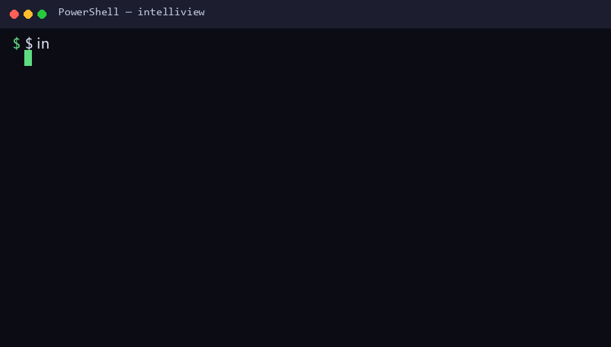
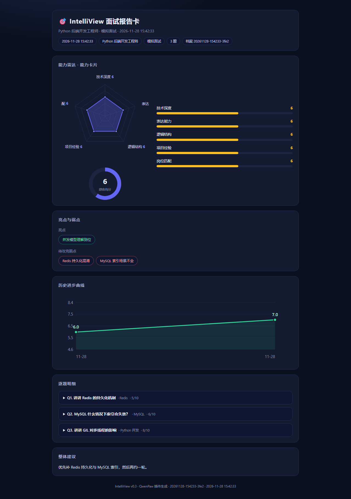

# IntelliView — AI Interview Coach That Remembers Your Mistakes

> An open-source interview training loop: **mock interview → error cards →
> spaced-repetition re-drills → visual report cards**. 100% local JSON data,
> zero deployment, no server — runs inside your own AI agent.

[中文文档](./README_zh.md) · [Changelog](./CHANGELOG.md) · [MIT License](./LICENSE)



## ✨ Why is this not "yet another AI mock-interview wrapper"?

| | Typical AI interview wrapper | IntelliView |
|---|---|---|
| Memory | Forgets after the chat | Failed questions (≤6/10) auto-become **error cards**, 1→3→7→14-day spaced repetition |
| Re-testing | Asks the same question | **Variants** — new scenario / new numbers / inverted framing (anti-memorization) |
| Pressure | None | **60-second timed** answers, one shot |
| Data | None | Session archive + user profile + recurring weaknesses + progress trend |
| Reports | A text blob | Self-contained **HTML report card**: radar chart + ability cards + trend line |
| Customization | Generic questions | Paste a JD → targeted bank, **or one-command open role packs** |
| Runtimes | One | **QwenPaw plugin / MCP / CLI** (any agent, or just a terminal) |

## 🚀 Quick Start

### 60-second preview (no API key needed)

```powershell
git clone https://github.com/MM-arthur/IntelliView.git
cd IntelliView
pip install .
intelliview demo        # seeds demo interviews + error cards + renders the report card
```



### Option A: MCP (any MCP client)

```powershell
pip install mcp
git clone https://github.com/MM-arthur/IntelliView.git
```

Add to your Claude Desktop / Cursor / Codex MCP config:

```json
{
  "mcpServers": {
    "intelliview": {
      "command": "python",
      "args": ["<path-to-repo>/mcp_server.py", "--data-dir", "C:/intelliview-data"]
    }
  }
}
```

Then just tell your agent: *"give me a mock interview"*, *"drill my error
cards"*, or *"interview me against this JD"*. Data lives in `~/.intelliview`
by default (override with `--data-dir`).

### Option B: CLI (no agent host needed — just a terminal)

```powershell
git clone https://github.com/MM-arthur/IntelliView.git
cd IntelliView
pip install .            # or: pip install ".[cli]"
set INTELLIVIEW_API_KEY=sk-...
intelliview              # free chat (default command)
intelliview interview    # a full mock interview
intelliview drill        # today's error-card drills
intelliview profile      # your profile — no LLM, reads local JSON
intelliview cards        # browse the error deck
intelliview history      # progress curve
intelliview bank use backend-python   # activate an open question pack
```

Any OpenAI-compatible endpoint works:

```powershell
set INTELLIVIEW_BASE_URL=https://your-endpoint/v1
set INTELLIVIEW_MODEL=your-model
```

### Option C: QwenPaw plugin

```powershell
pip install qwenpaw
qwenpaw init --defaults
qwenpaw plugin install ./intelliview-plugin
qwenpaw          # TUI, or `qwenpaw app` for the web console
```

## 🧠 The training loop

```
Mock interview (5-dim 1-10 scoring: depth / expression / logic / project / fit)
   └─ questions rated ≤6 ──→ 🃏 error card (what was wrong + model answer)
                               └─ due next day, auto-nagged every conversation
                                     └─ ⚡ 3-minute drill: variant question + 60s timer
                                           ├─ pass → interval grows 3/7/14d (3 in a row = mastered)
                                           └─ fail → retry tomorrow
Session end ──→ 💾 archive (JSON+MD) + 🧑‍💼 profile + 📊 HTML report card
```

## 📦 Architecture: one engine, many runtimes

```
intelliview-plugin/
├── intelliview_core.py            # core engine: archive/profile/cards/bank/report (zero SDK deps)
├── __init__.py                    # intelliview package (engine shared by all runtimes)
├── main.py                        # QwenPaw adapter (skills/hook/9 tools)
└── skills/intelliview/SKILL.md    # 8 interview modes + scoring anchors
mcp_server.py                      # MCP adapter (Claude / Cursor / Codex…)
cli.py                             # CLI adapter (pip install → `intelliview` command)
pyproject.toml                     # packaging + console script + [cli]/[mcp] extras
questions/                         # open question packs (one JSON = one role, PR-friendly)
docs/assets/                       # demo GIF + report-card screenshot
```

The engine knows nothing about its host: QwenPaw and MCP each inject a
duck-typed `context` (storage / logger / media); all state is local JSON.

## 📚 Question banks (community flywheel)

Open role packs live in [`questions/`](./questions/README.md) — each is one JSON
file (8-12 questions with follow-ups and difficulty). One command activates a
pack; mock interviews then draw from it, and failed questions feed the error
deck:

```powershell
intelliview bank list                  # 13 open packs + your custom ones
intelliview bank show backend-python   # preview
intelliview bank use backend-python    # import & activate
python cli.py bank validate questions  # contributor self-check
```

Custom packs without a PR: drop JSON into `~/.intelliview/question_packs/`.
Pack format and quality bar: [`questions/README.md`](./questions/README.md) +
[JSON schema](./questions/question-pack.schema.json) — PRs welcome 🎉

## 🤝 Contributing

- **Question banks**: add a pack in [`questions/`](./questions/README.md) — schema + validator + PR checklist ready
- Good first issues will be labeled soon
- The engine/adapter boundary is clean — new runtime adapters welcome (Telegram / WeChat / Slack…)
