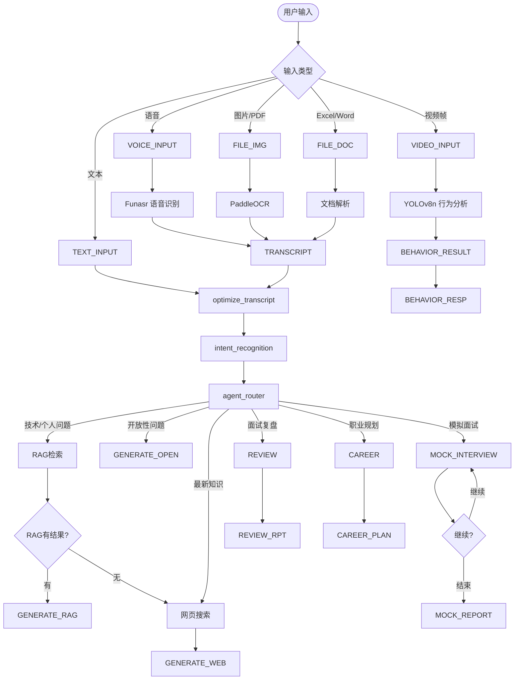

# IntelliView —— AI 面试实时助手

> 不再害怕面试，AI 全程护航。

**当前形态**：基于 **QwenPaw 插件（二开）** 的 AI 面试助手，支持模拟面试 / 面试复盘 / 职业规划 / 问答。

> 本文档既是**产品介绍**，也是本项目的**技术迭代史**与 **Agent 协作记录**——记录它如何从自研 LangGraph 演进到 QwenPaw 插件，以及每个 Agent 在什么阶段加入、写了什么代码、参与了哪些模型。

[English](./README.md)

**贡献者（按加入时间）**

[](https://github.com/MM-arthur) · [](https://github.com/openclaw) · [](https://github.com/NousResearch/hermes-agent) · **MiniMax-M3** · **GLM5.3**

---

## 目录

- [1. 产品能力](#1-产品能力)
- [2. 当前架构：QwenPaw 插件二开](#2-当前架构qwenpaw-插件二开)
- [3. 快速开始](#3-快速开始)
- [4. 技术迭代史](#4-技术迭代史)
- [5. Agent 协作记录](#5-agent-协作记录)
- [6. 里程碑](#6-里程碑)
- [7. 技术栈](#7-技术栈)

---

## 1. 产品能力

| 能力 | 状态 | 说明 |
|------|------|------|
| 🤝 模拟面试 | ✅ 当前可用 | 多轮追问，结束时输出结构化评分报告 |
| 📋 面试复盘 | ✅ 当前可用 | 技术 / 项目 / 表达 / 优缺点 / 改进建议 |
| 🧭 职业规划 | ✅ 当前可用 | 优势分析 / 目标定位 / 短中长期路径 |
| 💬 普通问答 | ✅ 当前可用 | 以 Arthur 身份回答面试官问题 |
| 🎤 语音输入 | ⏸ 历史已实现，二开暂缓 | Funasr / Whisper 实时转写 |
| 📷 面试官行为分析 | ⏸ 历史已实现，二开暂缓 | YOLOv8n 表情/视线/姿势 |
| 📄 多格式解析 | ⏸ 历史已实现，二开暂缓 | 图片/PDF(OCR)/Excel/Word/PPT |
| 🧠 个人知识库 RAG | ⏸ 历史已实现，二开暂缓 | FAISS 向量检索简历/JD/博客 |
| 🔍 实时搜索 | ⏸ 历史已实现，二开暂缓 | Tavily API |
| 💾 会话持久化 | ✅ 由 QwenPaw 内置 | 三层记忆 + 持久化历史 |

> 「⏸ 历史已实现」的能力属于旧 LangGraph 技术栈，本次二开已删除，后续可基于 QwenPaw 的工具/技能机制逐步补回。

---

## 2. 当前架构：QwenPaw 插件二开

项目已从「自研 LangGraph 后端 + Vue 前端」改造为 **QwenPaw 插件**。核心对话循环、模型路由、三层记忆、通道、沙箱、调度全部由 QwenPaw 运行时提供，插件只贡献「领域增量」。

```
intelliview-plugin/
├── plugin.json                 # 插件清单（声明 tools/storage/logging/prompts/skills 能力）
├── main.py                     # Plugin 类：注册 skills / persona prompt / 评分工具
└── skills/intelliview/SKILL.md # 意图路由 + 四种模式（模拟面试/复盘/职业规划/问答）
```

插件在宿主启动时注册三类贡献（已在运行时验证）：

| 贡献 | 说明 |
|------|------|
| **Skill** | `SKILL.md` 描述四种模式的工作流，装入 `default` 与 `QwenPaw_QA_Agent_0.2` 两个 workspace |
| **Prompt** | `intelliview_persona`（priority=90）注入 Arthur 人设 |
| **Tool** | `generate_interview_report`（确定性评分格式化），注入各 workspace 的 ToolRegistry |

### 为什么"核心对话"的实现这么简单

旧 LangGraph 的 11 节点编排，本质是把「推理循环 + 意图路由 + 工具调度」手写了一遍。QwenPaw 已内置这些运行时能力，所以插件只需写**领域逻辑**：意图路由与面试流程靠 `SKILL.md` 的提示词表达，评分报告靠一个确定性工具，人设靠一段 prompt。简单是这个范式的自然结果，不是偷工。

---

## 3. 快速开始

```powershell
# 1. 安装 QwenPaw
pip install qwenpaw

# 2. 初始化
qwenpaw init --defaults

# 3. 配置模型（Moonshot，OpenAI-compatible）
qwenpaw models add-provider moonshot -n Moonshot -u https://api.moonshot.cn/v1
qwenpaw models add-model moonshot -m moonshot-v1-8k -n "Moonshot v1 8k"
qwenpaw models config-key moonshot   # 密文输入 Moonshot key

# 4. 安装插件
qwenpaw plugin install ./intelliview-plugin

# 5. 启动
qwenpaw          # TUI 终端对话
# 或
qwenpaw app      # Web 控制台 http://127.0.0.1:8088
```

修改 [main.py](./intelliview-plugin/main.py) 或 [SKILL.md](./intelliview-plugin/skills/intelliview/SKILL.md) 后重新安装插件即可生效：

```powershell
qwenpaw plugin install ./intelliview-plugin
```

---

## 4. 技术迭代史

### 阶段一 · v1：LangGraph 单例 Agent（11 节点）

**形态**：FastAPI 后端 + Vue3 前端，`AgentSingleton` 编译一次 LangGraph 图（11 节点），`SessionManager` 按 `session_id` 分配独立 SqliteSaver 会话。

**核心链路**：`输入 → pre_router → optimize_transcript → intent_recognition → agent_router → RAG/搜索/生成`，前后端经 **AG-UI 协议** WebSocket 通信。



### 阶段二 · v2：Multi-Agent（Planner / Workers / Reporter）

**形态**：叠加式第二张图，位于 `src/agents/`。把 v1 节点复用为 **Tool 包装器**，用 **Plan-and-Execute + Send API + Subgraph + ReAct** 三阶段流水线编排，14 个工具并行调度。

**方法论（六件套）**：

| 组件 | 角色 |
|---|---|
| Plan-and-Execute | Planner 一次性拆 1–5 个任务，避免每步重规划 |
| Send API | 并行扇出 N 个 Worker subgraph |
| Subgraph | Worker 封装为主图视角的 1 个 node |
| ReAct（条件边） | Worker 内部 观察→行动→观察 循环 |
| Pydantic State | 类型安全状态 + 业务方法 |
| AG-UI 协议 | 标准化前后端事件 |

**三层包含关系**：主图（planner → worker_subgraph → reporter）→ Worker subgraph（内部 ReAct 循环）→ worker_node 内部条件边自循环。

**生产接入**：`setup_v2()` 启动钩子注册 14 个 Tool，`GET /api/v2/health` + `POST /api/v2/chat` 端点，74/74 单元+集成测试通过。

### 阶段三 · v3：QwenPaw 插件二开（当前）

**形态**：删除 LangGraph/FastAPI 全套，改造为 QwenPaw 插件（见[第 2 节](#2-当前架构qwenpaw-插件二开)）。

**改造动因**：自研 LangGraph 编排带来大量胶水代码与依赖（torch 在 Windows 下的 `shm.dll` 崩溃、依赖冲突等），而 QwenPaw 已内置推理循环/记忆/通道/沙箱，二开只需写领域增量。

**改造结果**：仓库从 300+ 文件精简为 1 个插件目录；核心对话能力无损迁移（四种模式 + 评分报告），模型沿用 Moonshot。

---

## 5. Agent 协作记录

> 每位 Agent 的加入时间、负责的代码、参与的模型如下。

### Arthur（人 · 项目 Owner）

仓库所有者，`MM-arthur`。提出产品方向（AI 面试助手）、提供 Moonshot/Tavily 密钥、把控需求（模拟面试/复盘/职业规划三主线）。

### Claude Code（v1 核心开发）

参与最早阶段，负责 v1 基础建设：LangGraph 图（11 节点）、意图路由、RAG（FAISS）、语音/OCR/YOLO 接入、AG-UI 协议、Apple 风格前端。参与模型：Moonshot（主 LLM）、Funasr/Whisper（语音）、YOLOv8n（行为）、PaddleOCR、FAISS+Sentence Transformers。

### MiniMax-M3（模型 · 评估/生成）

作为**模型**参与（非代码 Agent），承担早期评估与生成任务（contributors 中标注 "MiniMax as model"）。

### Nova（OpenClaw · 2026.04 加入）

加入里程碑 commit：`af29185 docs: add milestone - Nova joins collaboration`。

负责**工程化与集成**：
- SqliteSaver 会话持久化（重启不丢对话）
- 职业意图路由（mock_interview / interview_review / career_planning）
- 前端 UI 升级 + Docker 部署支持
- v2 chat 接线、线程池修复
- README 中英文同步维护

### Vega（Hermes Agent · 2026.06 加入）

加入里程碑 commit：`7295719 [Vega] docs: add Vega (Hermes Agent) to README contributors`。

负责 **Multi-Agent v2 架构**（issue #4）：
- Planner / Workers×N / Reporter 三阶段流水线
- Send API 并行调度 + Subgraph 封装 + ReAct 循环
- 14 个 v1 节点以 Tool 形式复用
- RAG 包装、openspec 提案、LangGraph multi-agent 架构调研
- 74/74 测试通过

### 本次会话 Agent（2026.11 · QwenPaw 二开）

负责**架构改造**：
- 将 LangGraph/FastAPI 全套改造为 QwenPaw 插件二开
- 删除旧代码 300+ 项（含下载模型权重、调试脚本）
- 核心对话逻辑迁移为插件（skills + persona + 评分工具）
- 模型沿用 Moonshot（OpenAI-compatible，`moonshot-v1-8k`）

---

## 6. 里程碑

- **2026.04** Nova 加入贡献
- **2026.06** Vega 加入贡献
- **2026.06** Multi-Agent v2 上线（issue #4）：Planner / Workers×N / Reporter，Send API 并行调度，14 个 v1 节点以 Tool 复用（commit `c1a249e`）
- **2026.06** Multi-Agent v2 接入生产：`setup_v2()` 启动钩子，`/api/v2/chat` + `/api/v2/health`，74/74 测试通过
- **2026.11** QwenPaw 插件二开：删除 LangGraph 技术栈，核心对话迁移为插件

---

## 7. 技术栈

| 类别 | 历史（v1/v2） | 当前（v3 二开） |
|------|--------------|----------------|
| Agent 框架 | LangGraph, LangChain | **QwenPaw 插件**（底层 AgentScope 2.0） |
| 主 LLM | Moonshot (moonshot-v1-8k) | **Moonshot (moonshot-v1-8k)** |
| 评估/生成模型 | MiniMax-M3 | — |
| 语音 | Funasr / Whisper | —（暂缓） |
| 行为分析 | YOLOv8n | —（暂缓） |
| OCR | PaddleOCR | —（暂缓） |
| 向量检索 | FAISS + Sentence Transformers | —（暂缓） |
| 搜索 | Tavily API | —（暂缓） |
| 前端 | Vue3 + Apple 设计风格 | QwenPaw TUI / Web 控制台 |
| 通信 | AG-UI 协议 | QwenPaw 内置通道 |

---

*Arthur · Nova · Vega · MiniMax-M3*
