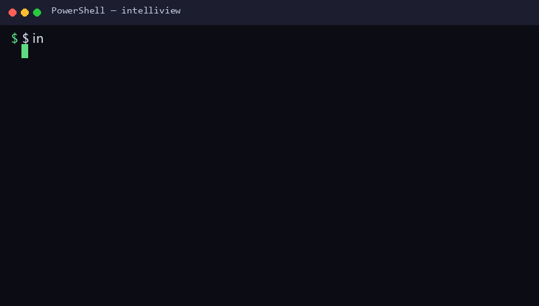
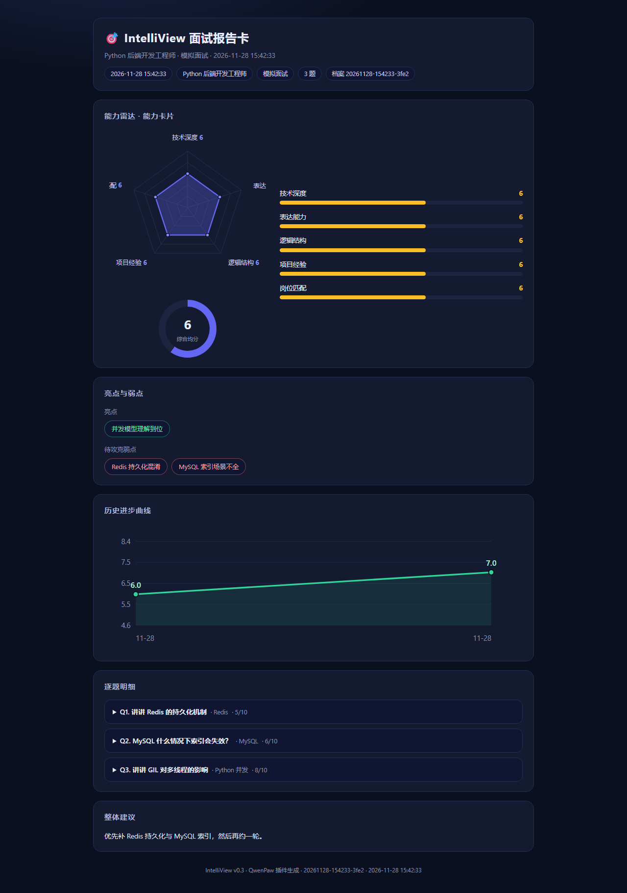

# IntelliView — AI 面试教练：答错的题，它会记仇

> 开源的面试训练闭环：**模拟面试 → 错题卡 → 间隔重复重测 → 可视化报告卡**。
> 数据 100% 本地 JSON 落盘、零部署、不上传任何服务器，跑在你自己的 Agent 里。

[English](./README.md) · [更新日志](./CHANGELOG.md) · [MIT License](./LICENSE)



## ✨ 与"又一个 AI 模拟面试"有何不同

| | 普通 AI 面试 wrapper | IntelliView |
|---|---|---|
| 记忆 | 聊完即散 | 答错/低分题自动进**错题卡**，1→3→7→14 天间隔重复 |
| 重测 | 原题重问 | **换场景 / 换数字 / 反着问**，防背答案 |
| 压力模拟 | 无 | **60 秒限时**一次成稿 |
| 数据 | 无 | 面试档案 + 用户画像 + 高频弱点 + 进步曲线 |
| 报告 | 一段文字 | 自包含 **HTML 报告卡**：雷达图 + 能力卡片 + 趋势线 |
| 定制 | 泛泛而问 | 粘贴 JD 生成题库，**或一条命令启用开源岗位包** |
| 运行时 | 单一 | **QwenPaw 插件 / MCP / CLI**（任何 Agent，或只用终端） |

## 🚀 快速开始

### 60 秒预览（不需要 API Key）

```powershell
git clone https://github.com/MM-arthur/IntelliView.git
cd IntelliView
pip install .
intelliview demo        # 写入演示面试档案 + 错题卡 + 渲染 HTML 报告卡
```



### 方式 A：MCP（任何 MCP 客户端）

```powershell
pip install mcp
git clone https://github.com/MM-arthur/IntelliView.git
```

在 Claude Desktop / Cursor / Codex 的 MCP 配置中加入：

```json
{
  "mcpServers": {
    "intelliview": {
      "command": "python",
      "args": ["<你的仓库路径>/mcp_server.py", "--data-dir", "C:/intelliview-data"]
    }
  }
}
```

然后直接对 Agent 说：**"来一场模拟面试"**、**"错题重测"**、**"按这个 JD 面我"**。
面试数据默认存 `~/.intelliview`（可用 `--data-dir` 改）。

### 方式 B：CLI（不需要任何 Agent 宿主，有终端就行）

```powershell
git clone https://github.com/MM-arthur/IntelliView.git
cd IntelliView
pip install .            # 或：pip install ".[cli]"
set INTELLIVIEW_API_KEY=sk-...
intelliview              # 自由聊天（默认命令）
intelliview interview    # 一场完整模拟面试
intelliview drill        # 今天的错题特训
intelliview profile      # 用户画像（免 LLM，直读本地 JSON）
intelliview cards        # 查看错题本
intelliview history      # 进步曲线
intelliview bank use backend-python   # 启用开源题库（岗位包）
```

支持任意 OpenAI-compatible 端点：

```powershell
set INTELLIVIEW_BASE_URL=https://你的端点/v1
set INTELLIVIEW_MODEL=你的模型
```

### 方式 C：QwenPaw 插件

```powershell
pip install qwenpaw
qwenpaw init --defaults
qwenpaw plugin install ./intelliview-plugin
qwenpaw          # TUI，或 qwenpaw app 走 Web 控制台
```

## 🧠 训练闭环

```
模拟面试（五维 1-10 评分：技术深度/表达/逻辑/项目/岗位匹配）
   └─ 评分 ≤6 的题 ──→ 🃏 错题卡（丢分点 + 参考答案要点）
                          └─ 次日到期，每次对话自动催练
                                └─ ⚡ 3 分钟特训：换角度出题 + 60 秒限时
                                      ├─ 通过 → 间隔升级 3/7/14 天（连续 3 次 = 掌握）
                                      └─ 失败 → 明日重测
面试结束 ──→ 💾 档案（sessions/ JSON+MD）+ 🧑‍💼 画像 + 📊 HTML 报告卡
```

## 📦 架构：一个引擎，多个运行时

```
intelliview-plugin/
├── intelliview_core.py            # 核心引擎：档案/画像/错题/题库/报告（零 SDK 依赖）
├── __init__.py                    # intelliview 包（所有运行时共享同一引擎）
├── main.py                        # QwenPaw 适配器（注册技能/钩子/9 工具）
└── skills/intelliview/SKILL.md    # 8 种面试模式与评分锚点
mcp_server.py                      # MCP 适配器（Claude / Cursor / Codex…）
cli.py                             # CLI 适配器（pip install 后得到 intelliview 命令）
pyproject.toml                     # 打包 + 命令行入口 + [cli]/[mcp] 可选依赖
questions/                         # 开源题库（一个 JSON = 一个岗位，PR 友好）
docs/assets/                       # 演示 GIF + 报告卡截图
```

核心引擎不知道宿主是谁：QwenPaw 与 MCP 各自注入满足鸭子类型的
`context`（storage / logger / media），所有状态落盘本地 JSON。

## 📚 开源题库（社区飞轮）

岗位包放在 [`questions/`](./questions/README.md)：一个 JSON 文件 = 一个岗位
（8-12 题，含追问与难度）。一条命令导入并激活，之后模拟面试按题库出题，
答错的题照常进错题本：

```powershell
intelliview bank list                  # 13 个开源岗位包（AI 工程 / 通用技术）+ 自定义包
intelliview bank show backend-python   # 预览
intelliview bank use backend-python    # 导入并激活
python cli.py bank validate questions  # 贡献者自检
```

不想发 PR 也行：把 JSON 丢进 `~/.intelliview/question_packs/` 就会被发现。
题包格式与质量要求见 [`questions/README.md`](./questions/README.md) +
[JSON Schema](./questions/question-pack.schema.json)，欢迎 PR 🎉

## 🤝 贡献

- **题库贡献**：在 [`questions/`](./questions/README.md) 加一个岗位包 —— Schema、校验器、PR checklist 都已就绪
- good first issues 即将标注
- 引擎与适配器边界清晰，欢迎新的运行时适配器（Telegram / 微信 / Slack…）
